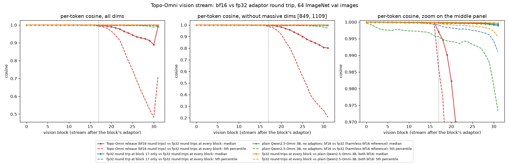
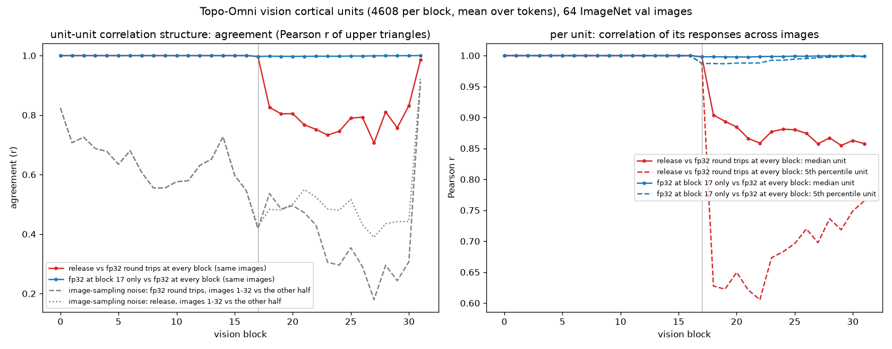

# bf16 round trip in the vision adaptors

**Finding:** in bf16, vision block 17's `CorticalAdaptor` does not give back its input. The error grows through blocks 18–31 and changes the cortical units there. A float32 round trip fixes it without retraining (commit `fd0f9e1` on this branch).

Setup: the public release (`epfl-neuroai/topo-omni`), 64 ImageNet val images (224×224), torch 2.9.1, transformers 4.57.6, run with `scripts/bf16_round_trip_check.py`. All numbers are in [`results.json`](results.json). The draft issue is [`issue.md`](issue.md).

## Cause

- W17 has condition number **548**, while the other 31 blocks range from 2.3 to 9.2. One singular value collapsed to 0.0136; the rest are ≥ 1.3. At init (tiled identity + 1e-3 noise) all singular values were between 1.7 and 2.0, so training made it.
- Block 17's input has massive activations on dims 849 (up to 9,536) and 1109 (up to 2,864), on 1.6% of tokens. The next largest dim reaches 66.
- In bf16, rounding Z on those tokens costs about 0.4% of a large number, and `pinv(W17)` amplifies that error ~73× along the collapsed direction.

Block 17 round trip on its real input. Cosine with X and relative error are computed over the ordinary dims only:

| tokens | bf16 cosine (median) | bf16 rel. error | fp32 cosine |
|---|---|---|---|
| with a massive value | **0.31** | 2.7 | 1.000 |
| the others | 0.998 | 0.07 | 1.000 |

## The stream after each block

The release and the fix are identical up to block 16 and diverge from 17 on. At block 30 the median per-token cosine is 0.89 (0.81 without the massive dims); plain Qwen in bf16 vs fp32 stays at 0.9995. Fixing only block 17 lands on the plain-Qwen line, and the fixed stream matches plain Qwen (≥ 0.9997).

## The cortical units

Z is averaged over tokens per image. From block 18 on, the median unit's responses across images correlate r ≈ 0.86 between release and fix, and the worst 5% of units fall to 0.6–0.75. Fixing only block 17 stays ≥ 0.987. Unit-unit correlation structure agrees 0.71–0.83. The grey split-half lines show that this measure is noisy with 64 images, so the per-unit numbers are the more reliable signal.

## Not measured

- Whether the paper's maps or numbers change. Next step: rerun one selectivity category from the OSF cut with release vs fix.
- Behaviour (captions, loss).
- When W17 collapsed during training. That needs the authors' intermediate checkpoints.
